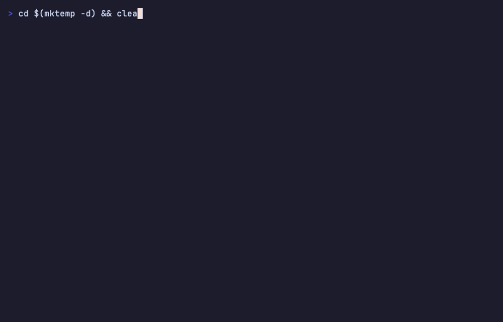

# okfctl

[](https://github.com/cwest/okfctl/actions/workflows/ci.yml)
[](https://github.com/cwest/okfctl/releases/latest)
[](https://pkg.go.dev/github.com/cwest/okfctl)
[](LICENSE)

`okfctl` is a command-line tool for people who keep a knowledge base in
Markdown and want it to stay correct as it grows. It writes and checks
[Open Knowledge Format](https://github.com/open-knowledge-format/open-knowledge-format/blob/main/SPEC.md)
(OKF) bundles: folders of Markdown files ("nodes") that link to each other and
record where their facts came from in YAML frontmatter. Rename a node and okfctl
rewrites every link that pointed at it. Put `okfctl lint --strict` in CI and a
node that names another without linking to it fails the build, as the run below
shows.

**Website:** [okfctl.dev](https://okfctl.dev) &nbsp;•&nbsp;
**Docs:** [`docs/`](docs/README.md) &nbsp;•&nbsp;
**Contributing:** [CONTRIBUTING.md](CONTRIBUTING.md) &nbsp;•&nbsp;
**Security:** [SECURITY.md](SECURITY.md) &nbsp;•&nbsp;
**Conduct:** [CODE_OF_CONDUCT.md](CODE_OF_CONDUCT.md)

## See it catch something

Make a bundle with two nodes. Have one of them mention the other without
linking to it:

<!-- transcript: exit 1 okfctl lint --strict mykb -->
```text
$ okfctl bundle init mykb
Initialized OKF bundle in mykb
$ okfctl node new concepts/tannin.md --type Reference --title "Tannin" --bundle mykb
Created mykb/concepts/tannin.md
$ okfctl node new concepts/oak.md --type Reference --title "Oak" --bundle mykb
Created mykb/concepts/oak.md
$ echo 'Oak barrels add tannin to red wine.' >> mykb/concepts/oak.md
$ okfctl validate mykb
OK: bundle conforms to the OKF spec floor
$ okfctl lint mykb
missing-xref: concepts/oak.md mentions "Tannin" but does not link to concepts/tannin.md
1 lint finding(s)
$ okfctl lint --strict mykb
missing-xref: concepts/oak.md mentions "Tannin" but does not link to concepts/tannin.md
1 lint finding(s)
okfctl: 1 lint finding(s)
```

`validate` passes. The bundle meets the spec's floor: all the frontmatter
parses, and the reserved `index.md` and `log.md` files are well formed (OKF
§11.1). `lint` reads past the floor and finds the oak node talking about tannin
with no link. By default it exits 0. With `--strict` it exits 1, and that is
the line you put in CI.

Notice you never ran an index command. `node new` rebuilt both `index.md` files
and logged each node in `log.md` as it went, which is why
`okfctl index check mykb` prints `OK: index.md is current`.



okfctl is written in pure Go and runs offline. Only `connect` reaches the
network, when it calls git to clone a remote bundle. Try
`okfctl search "tannin" mykb` to find nodes by text and `okfctl graph export mykb`
to dump the link graph as JSON. `okfctl analyze mykb` shows where the bundle is
thin. Each subcommand's `--help` includes an example you can paste.

## Install

Pick one of these three. Each one gets you `okfctl` and the `okfctl-search`
plugin.

With [Homebrew](https://brew.sh) on macOS or Linux:

```sh
brew install cwest/tap/okfctl
```

Or use the install script on macOS or Linux. It grabs the release archive for
your OS and CPU and checks it against the release's `checksums.txt`. If they
don't match, it installs nothing:

```sh
curl -sSL https://okfctl.dev/install.sh | sh
```

Or, with Go 1.26 or later, build from source:

```sh
go install github.com/cwest/okfctl@latest
go install github.com/cwest/okfctl/cmd/okfctl-search@latest
```

Run `okfctl version` to check that it worked. The
[install guide](docs/install.md) shows what each method prints. It also has
the prebuilt archives, the Debian and RPM packages, how to check a release's
signature, and how to build from a checkout.

## The spec decides what's valid

The
[Open Knowledge Format spec](https://github.com/open-knowledge-format/open-knowledge-format/blob/main/SPEC.md)
decides what a valid bundle is, and okfctl follows it. In the `mykb` bundle
from above, add a node with a made-up `type` and a frontmatter key okfctl has
never seen. Then try to create a node with no type at all:

<!-- transcript: exit 1 okfctl node new concepts/cork.md --title "Cork" --bundle mykb -->
```text
$ printf '%s\n' '---' 'type: Recipe' 'title: Mulled wine' 'x-acme-owner: casey' '---' '' 'Warm red wine with spices.' > mykb/mulled-wine.md
$ okfctl validate mykb
OK: bundle conforms to the OKF spec floor
$ okfctl node new concepts/cork.md --title "Cork" --bundle mykb
okfctl: --type is required (OKF §4.1 / §11: every node needs a non-empty type)
```

`validate` passed the recipe because the spec tells a tool to accept types and
keys it doesn't know (OKF §11.2). `node new` refused the cork node with exit
code 1 since the spec also says each concept has a non-empty `type` (§4.1).

`validate` holds each bundle to that floor and no higher. If your team wants
a stricter rule, like a `servings` field on each Recipe, put it in a type
template. Templates run only when you call `okfctl validate --templates`.

## Commands

Run `okfctl <cmd> --help` for the flags. The
[command reference](docs/commands/README.md) has the same text in one place.

To build and edit a bundle:

| Command | What it does |
| :-- | :-- |
| [`bundle`](docs/commands/README.md#okfctl-bundle) | Create a bundle (`init`) and summarize one (`info`). |
| [`node`](docs/commands/README.md#okfctl-node) | Work with one node at a time: `new`, `show`, `list`, `edit`, `mv`, `rm`, `refresh`, and `promote`. |
| [`index`](docs/commands/README.md#okfctl-index) | Rebuild (`build`) and check (`check`) the reserved `index.md`. |
| [`log`](docs/commands/README.md#okfctl-log) | Add to (`append`) and print (`show`) the reserved `log.md` history. |

To check a bundle:

| Command | What it does |
| :-- | :-- |
| [`validate`](docs/commands/README.md#okfctl-validate) | Check the bundle against the OKF spec floor, and against your type templates with `--templates`. |
| [`lint`](docs/commands/README.md#okfctl-lint) | Report curation findings such as orphans, broken links, and missing links. `--strict` makes findings fail CI. |
| [`eval`](docs/commands/README.md#okfctl-eval) | Check that each node has a grade and citations (`transparency`), and draft a spot-check set for accuracy, alignment, and calibration, which a person has to judge (`sample`). |

To explore what you've made:

| Command | What it does |
| :-- | :-- |
| [`analyze`](docs/commands/README.md#okfctl-analyze) | Report where the bundle is weak: freshness, clusters, gaps, connectivity, structure. |
| [`search`](docs/commands/README.md#okfctl-search) | Find nodes by text, or by how close they sit in the link graph. |
| [`graph`](docs/commands/README.md#okfctl-graph) | Export the link graph as JSON or as Graphviz `dot`; pick one with `--format`. |
| [`serve`](docs/commands/README.md#okfctl-serve) | Browse the bundle as an interactive graph in your browser. |

Everything else:

| Command | What it does |
| :-- | :-- |
| [`template`](docs/commands/README.md#okfctl-template) | Print the type templates a bundle declares (`list`) and one template in full (`show`). |
| [`migrate`](docs/commands/README.md#okfctl-migrate) | Move a v0.1 or v0.2 bundle to OKF v0.3: write a plan file of the edits, then apply it. |
| [`registry`](docs/commands/README.md#okfctl-registry) | Keep a list of named remote bundles, the way `git remote` keeps remotes. |
| [`connect`](docs/commands/README.md#okfctl-connect) | Clone a remote bundle into a local directory, or fast-forward one you already have. |
| [`plugin`](docs/commands/README.md#okfctl-plugin) | Find (`list`) and install (`install`) `okfctl-<name>` plugins on your `PATH`. |
| [`config`](docs/commands/README.md#okfctl-config) | Get, set, and list okfctl settings. |
| [`completion`](docs/commands/README.md#okfctl-completion) | Print a shell completion script for bash, zsh, or fish. |
| [`version`](docs/commands/README.md#okfctl-version) | Print the version (`okfctl --version` does the same). |

Semantic search comes in the `okfctl-search` plugin, installed with okfctl.
Out of the box it matches words. To search by meaning, download a
[Model2Vec](https://github.com/MinishLab/model2vec) model like
[`minishlab/potion-base-8M`](https://huggingface.co/minishlab/potion-base-8M)
and tell okfctl where it is. The plugin loads the model itself. okfctl won't
download one for you. Run `okfctl-search index build` first to embed your
nodes, then `okfctl-search --semantic "query"`. Skip the build and
`--semantic` exits 1 with a note to run it. The
[search guide](docs/guides/search.md) walks you through each step.

## Use as an agent plugin

This repo is also an [Agent Plugins 1.0.0](https://agent-plugins.org) package.
Any agent client that reads the format can install its four okfctl skills
(`okf-authoring`, `okf-curation-health`, `okf-migrate-plan`, and
`okf-semantic-search`) in one step from the root [`plugin.json`](plugin.json).
Clients that read repo instructions pick up the same advice
from [`AGENTS.md`](AGENTS.md).

Don't mix this up with `okfctl plugin`. It looks for executables named
`okfctl-<name>` on your `PATH`, like `okfctl-search`. This section is about
giving okfctl's skills to an AI agent under a different spec.

The skills call the `okfctl` binary. The plugin client won't install it for
you. [Install okfctl](#install) first:

```sh
brew install cwest/tap/okfctl
```

The manifest has no version field. The release tag is the version, and
`okfctl version` reports it.

## Learn more

Start with the [concepts](docs/concepts.md) page. The
[docs index](docs/README.md) then lists a guide for each job, from authoring a
bundle to pulling in remote ones. If CI flags drift after a bulk reformat, the
[freshness guide](docs/guides/index-and-freshness.md) shows how
`.okf-drift-ignore-revs` tells okfctl to skip that commit.

`okfctl <cmd> --help` always matches the binary you've got.

okfctl targets OKF v0.3. The
[v0.3 specification](https://github.com/open-knowledge-format/open-knowledge-format/blob/main/SPEC.md)
lives upstream. [This record](docs/specs/2026-11-26-okf-v0.3-gap-analysis.md)
lists how each v0.3 change landed here.

To work on okfctl itself, read [`docs/PRD.md`](docs/PRD.md), the
[architecture decision records](docs/adr/README.md), and the dated
[plans](docs/plans/2026-07-22-roadmap.md) and [specs](docs/specs/) behind each
release.

## License

Apache-2.0. See [LICENSE](LICENSE).
